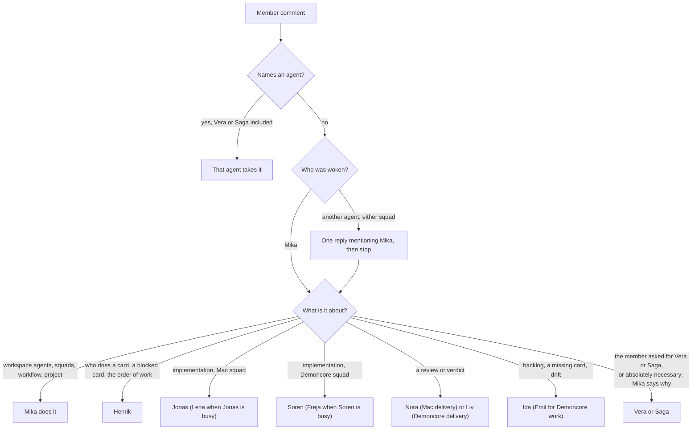
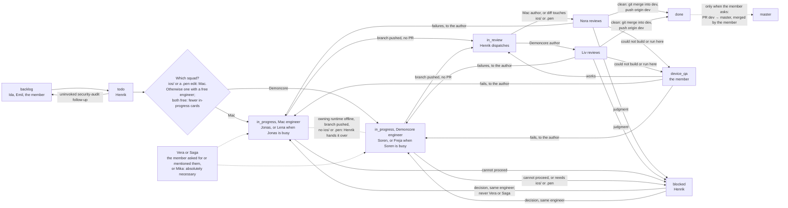

# Routing

Who takes what, as the live agent, squad and workflow texts encode it on 2026-11-10, after the
Demoncore squad was added. The texts in [agents/](agents/), [squad.md](squad.md) and
[workflow.md](workflow.md) are authoritative; this page summarises them so a reader can check a
restored workspace against them.

## Agents and models

| Agent | Board name | Squad | Model | Thinking | Runtime kind | Max concurrent | Takes |
| ----- | ---------- | ----- | ----- | -------- | ------------ | -------------- | ----- |
| Mika | `Mika` | none | `grok-4.7` | runtime default | Docker Grok | 3 | Every member comment that names no agent; the workspace's own agents, squads, workflow and project; the only agent that may assign Vera or Saga, and only when it is absolutely necessary |
| Henrik | `[Docker] Development Manager - Henrik` | leader of both | `grok-4.7` | `high` | Docker Grok | 3 | `todo`, `in_review` (only to dispatch the reviewer) and `blocked`; routes both squads; project lead. Never assigns Vera or Saga |
| Nora | `[Macbook] Code Reviewer - Nora` | MacBook | `grok-4.7` | `high` | Mac Grok | 2 | The review of a Mac author's card, or of any diff that touches `ios/` or a `.pen` file, once Henrik assigns it |
| Vera | `[Macbook] Senior Full-Stack Engineer - Vera` | MacBook | `claude-fable-5-2` | `high` | Mac Claude | 2 | Only a card the member asked for her on or mentioned her on, or one Mika assigned her because it is absolutely necessary. Not a review step |
| Jonas | `[Macbook] Full-Stack Engineer - Jonas` | MacBook | `claude-opus-5-5` | `high` | Mac Claude | 2 | Mac implementation on every platform, the only engineers for `ios/` and `.pen` edits; first choice |
| Lena | `[Macbook] Full-Stack Engineer - Lena` | MacBook | `claude-opus-5-5` | `high` | Mac Claude | 2 | Mac implementation, when Jonas already has an implementation card |
| Ida | `[Macbook] Shroud Planner - Ida` | MacBook | `claude-opus-5-5` | `high` | Mac Claude | 2 | The backlog, card briefs, drift audits; read-only on code |
| Soren | `[Demoncore] Full-Stack Engineer - Soren` | Demoncore | `claude-opus-5-5` | `high` | Windows Claude | 2 | Demoncore implementation in `server/`, `admin/`, `web/` and `android/`; first choice. No `ios/`, no `.pen` edits |
| Freja | `[Demoncore] Full-Stack Engineer - Freja` | Demoncore | `claude-opus-5-5` | `high` | Windows Claude | 2 | Demoncore implementation, when Soren already has an implementation card |
| Liv | `[Demoncore] Code Reviewer - Liv` | Demoncore | `grok-4.7` | `high` | Windows Grok | 2 | The review of a Demoncore author's card, once Henrik assigns it. Not `ios/` |
| Saga | `[Demoncore] Senior Full-Stack Engineer - Saga` | Demoncore | `claude-fable-5-2` | `high` | Windows Claude | 2 | Only a card the member asked for her on or mentioned her on, or one Mika assigned her because it is absolutely necessary. No iOS |
| Emil | `[Demoncore] Shroud Planner - Emil` | Demoncore | `claude-opus-5-5` | `high` | Windows Claude | 2 | Planning for work the Demoncore squad can do, when the member asks that squad to plan or Ida's runtime is offline. Never duplicates Ida's cards |
| The member | workspace owner | both | — | — | — | — | Device QA, product choices, every pull request (`dev` → `master`), merging `master` |

## Two squads

- **`Shroud MacBook`** runs on the member's MacBook: Jonas, Lena, Nora, Vera and Ida. It is the only
  squad that touches `ios/` or edits `design/*.pen`, and it can also take every other platform.
- **`Shroud Demoncore`** runs on the Windows machine DESKTOP-BTQHK4R: Soren and Freja implement, Liv
  reviews, Saga is the senior, Emil plans. It implements and reviews `server/`, `admin/`, `web/` and
  `android/`. It never builds iOS and never edits a `.pen` file; a Demoncore agent that gets a card
  touching either moves it to `blocked` for the Mac squad and stops.
- **Henrik leads and routes both.** One card, one squad. A card that touches `ios/` or needs a `.pen`
  edit goes to the Mac squad. Otherwise he picks the squad that has a free engineer; if both do, the
  one with fewer in-progress cards.
- **The squad that has the card finishes it.** The other squad continues it only when the owning
  runtime is offline, the branch is already pushed, and the card does not touch `ios/` or
  `design/*.pen`, and only when Henrik assigns it. Two squads never run one card.
- **Planning.** Ida plans for the workspace. Emil does not create a card Ida already created; he
  plans when the member asks the Demoncore squad to plan, or when Ida's runtime is offline.

## When Vera and Saga run

Vera (Mac) and Saga (Demoncore) both run `claude-fable-5-2`, and both run in exactly three cases:

- the member asked for that person on the card;
- the member mentioned them;
- Mika assigned them because it is absolutely necessary. Mika's text defines that for Vera as: Jonas
  and Lena cannot produce a correct result, and the defect is a security or correctness failure that
  cannot wait; for Saga it says "same invocation rule as Vera". Mika says why in the comment that
  assigns them.

Nothing else starts them. Henrik does not decide that one is needed and does not assign either from
`todo`, `in_review` or `blocked`; a card whose Owner line says `senior` without one of those three
goes to the squad's engineers. Neither is a review step: no reviewer sends work to them, and a
review return stays with the author. A harder feature, a second review or a quality preference is
not a reason to call them, and neither is difficulty for the engineers, who hand a card back only
when the member asked for Vera or Saga or mentioned them.

## Member comments

- The member writes and names no agent: Mika reads it and talks to the one agent it concerns, in one
  reply on the same thread with a real mention and the member's words, then stops. A comment about
  the workspace's agents, squads, workflow or project is Mika's own work.
- The member names an agent: that agent takes it, and Mika stays out. Naming Vera or Saga is one of
  the cases in which they run.
- Any other agent woken by an unnamed member comment, on either squad, replies once, mentions Mika
  with what the member wrote, and stops. When Mika routes the member's words to an agent, that agent
  does the work and does not hand it back.

## Cards

- **`todo` — Henrik** picks the squad (see [Two squads](#two-squads)), then the engineer by the
  card's Owner line: Jonas, or Lena when Jonas already has an implementation card, on the Mac;
  Soren, or Freja when Soren already has one, on Demoncore. Server contracts, migrations, crypto,
  calls, Android `core/` and a chore that only runs the existing suites are implementation like any
  other. Henrik starts a card with one
  `multica issue update <id> --assignee-id <engineer> --status in_progress` and leaves it in `todo`
  while the engineer he would pick already has an implementation card, another card that changes
  visible UI is in progress, or another in-progress card touches the same platform directory.
- **Vera and Saga** are not Henrik's to assign; see [When Vera and Saga run](#when-vera-and-saga-run).
- **Security-audit follow-ups** from `docs/security-audit-2026-10.md` are not created or started
  unless the member invoked that follow-up. One that reaches `todo` uninvoked goes back to `backlog`,
  not to Vera or Saga. The planners do not open those cards on their own.
- **`in_progress` — the assigned engineer** does every work item, runs the suite of every platform
  touched on their own machine (Android included on both), pushes the feature branch to origin,
  posts one delivery comment and moves the card to `in_review`. No pull request.
- **`in_review` — Henrik dispatches, the squad's reviewer reviews.** The status wakes Henrik. He reads
  the author from the delivery comment and assigns Nora for a Mac author (Jonas, Lena, Vera) and Liv
  for a Demoncore author (Soren, Freja, Saga); a diff that touches `ios/` or a `.pen` file goes to
  Nora even when a Demoncore engineer touched the branch. He does not review the diff. The reviewer
  runs the suites again and posts one verdict.
  - Clean, no faults: she merges the feature branch into `dev` with git, pushes `origin dev`, and
    moves the card to `done`. She does not open a pull request and never pushes `master`.
  - Failures, a Blocker or Major, or an unmet criterion, including a later pass: back to
    `in_progress`, assigned to the author. Never to Vera or Saga.
  - Clean, but something her machine could not build or run (a device run the simulator cannot
    cover), or the Pencil `save` tool was unavailable: `device_qa`.
  - A judgment the docs do not settle: `blocked`.
- **`device_qa` — the member** builds or runs what the reviewer could not. It works: back to
  `in_review` (the step's next status), which wakes Henrik to dispatch the reviewer again, who
  merges the branch. It fails: `in_progress` with what failed.
- **`blocked` — Henrik** resolves it from the issue, `docs/`, `AGENTS.md` and `docs/agent-rules/`
  and sends it back to `in_progress` to the same engineer. A Demoncore card blocked because it needs
  `ios/` or a `.pen` edit belongs to the Mac squad. He does not assign Vera or Saga himself. The
  member only for a real product choice, with a TLDR.
- **`master`** belongs to the member. A pull request exists only when the member asks for one, and
  it is always `dev` → `master`. Only the member merges `master`.

## Checking a restored workspace

- [ ] Twelve agents with the board names, models and thinking levels in the table above, each on
      the runtime kind shown.
- [ ] Every agent's instructions equal its file under [agents/](agents/) after `ids.sed`; no
      instruction mentions an old UUID.
- [ ] Squad `Shroud MacBook`: leader Henrik, the six other members with their roles, and the
      instructions in [squad.md](squad.md).
- [ ] Squad `Shroud Demoncore`: leader Henrik, the six other members with their roles, and the
      instructions in [squad.md](squad.md) with the new IDs.
- [ ] Workflow `Shroud delivery` with the eight statuses, handlers, next and back in
      [workflow.md](workflow.md) (`in_review` handled by Henrik, Device QA's next is `in_review`),
      and the handoff texts with the new IDs.
- [ ] Project `Shroud` on that workflow (`uses_default: false`), lead Henrik, with the `github_repo`
      resource `https://github.com/AsP3X/shroud` on ref `dev`.
- [ ] A test card in `todo` with an `Owner: engineer` line that touches `ios/` wakes Henrik, who
      assigns Jonas (or Lena) and moves it to `in_progress`.
- [ ] A test card in `todo` that touches only `web/`, while both squads have a free engineer and the
      Mac squad has more in-progress cards, goes to Soren (or Freja).
- [ ] A test card in `todo` with an `Owner: senior` line, which the member neither asked Vera or Saga
      for nor mentioned them on, goes to an engineer, not to Vera or Saga.
- [ ] A Demoncore delivery moved to `in_review` wakes Henrik, who assigns Liv without reviewing it; a
      Mac delivery gets Nora.
- [ ] A member comment that names no agent on a card assigned to Jonas or Soren gets one reply from
      that engineer that mentions Mika, and Mika routes it.

## Where the live texts still disagree

Copied as they are, since the CLI is the source of truth. They are worth fixing in the workspace,
then here.

From before the Demoncore squad:

- Vera's description ("Optional. Runs only for a high-quality pass, or when the member invokes
  her.") and her squad role ("Optional high-quality pass, or a security review the member
  invoked.") still describe the earlier rule. Her instructions, Mika's, Henrik's, the squad
  instructions and the `todo` and `blocked` handoffs limit her to the member's request or mention,
  or Mika's assignment when it is absolutely necessary.
- Henrik's conversation starter "Resolve a blocked card" still ends "otherwise ask the senior
  engineer or escalate to the member", while his instructions and the `blocked` handoff say he does
  not assign Vera.
- Nora's instructions still give "Android without an SDK" as an example of what this Mac could not
  build. The SDK is installed, and her own verification section and the engineers' instructions run
  the Android check without that exception. Liv's instructions repeat the same example.

Since the Demoncore squad:

- The `todo` handoff's first paragraph still sends everything that is not Vera's to Jonas or Lena;
  the paragraph appended after it adds the Demoncore squad and the one-squad-per-card rule. Henrik's
  instructions follow the second.
- Henrik's instructions still describe `in_review` as "the reviewer" with "A change this Mac could
  not build goes to Device QA", and his rules say "Nora merges the branch into `dev`", alongside the
  new lines that he dispatches Nora or Liv. His description still says "Leads the Shroud development
  team", the Mac squad's old name.
- The `device_qa` handoff still says "move the card to in_review so Nora merges the branch". For a
  Demoncore card it is Liv, after Henrik dispatches her again.
- The workflow description still reads "in_review (reviewer)" and "anything this Mac could not
  build"; the `in_review` handler is now Henrik.
- Liv's instructions list the authors as Vera, Jonas and Lena (copied from Nora's) rather than Soren,
  Freja and Saga. She also identifies the author from the delivery comment and the assignee history,
  so a return still reaches the right engineer.
- Saga's instructions say routine server contracts, migrations, crypto, calls and Android `core/`
  "belong to Jonas and Lena", the Mac engineers; on Demoncore those are Soren's and Freja's.
- The "Demoncore boundary" paragraph is the same in all five Demoncore agents, so Liv's and Emil's
  copies say "You implement and review `server/`, `admin/`, `web/`, and `android/`" although Liv only
  reviews and Emil is read-only on code. Emil's text also still says "You are the only agent that
  creates and orders cards", while Henrik's and the Demoncore squad's say Emil does not duplicate
  Ida's cards and plans only when asked or when Ida's runtime is offline.
