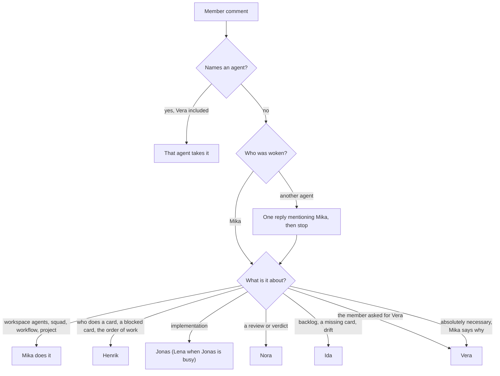
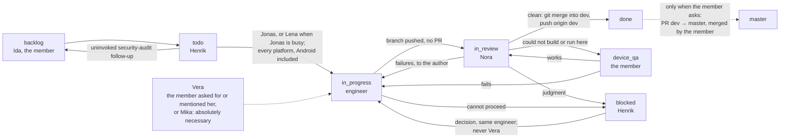

# Routing

Who takes what, as the live agent, squad and workflow texts encode it on 2026-11-10. The texts in
[agents/](agents/), [squad.md](squad.md) and [workflow.md](workflow.md) are authoritative; this page
summarises them so a reader can check a restored workspace against them.

## Agents and models

| Agent | Board name | Model | Thinking | Runtime kind | Max concurrent | Takes |
| ----- | ---------- | ----- | -------- | ------------ | -------------- | ----- |
| Mika | `Mika` | `grok-4.7` | runtime default | Docker Grok | 3 | Every member comment that names no agent; the workspace's own agents, squad, workflow and project; the only agent that may assign Vera, and only when it is absolutely necessary |
| Henrik | `[Docker] Development Manager - Henrik` | `grok-4.7` | `high` | Docker Grok | 3 | `todo` and `blocked`; squad leader; project lead. Never assigns Vera |
| Nora | `[Macbook] Code Reviewer - Nora` | `grok-4.7` | `high` | Mac Grok | 2 | `in_review` |
| Vera | `[Macbook] Senior Full-Stack Engineer - Vera` | `claude-fable-5-2` | `high` | Mac Claude | 2 | Only a card the member asked for her on or mentioned her on, or one Mika assigned her because it is absolutely necessary. Not a review step |
| Jonas | `[Macbook] Full-Stack Engineer - Jonas` | `claude-opus-5-5` | `high` | Mac Claude | 2 | Implementation on every platform, Android included, first choice |
| Lena | `[Macbook] Full-Stack Engineer - Lena` | `claude-opus-5-5` | `high` | Mac Claude | 2 | Implementation, when Jonas already has an implementation card |
| Ida | `[Macbook] Shroud Planner - Ida` | `claude-opus-5-5` | `high` | Mac Claude | 2 | The backlog, card briefs, drift audits; read-only on code |
| The member | workspace owner | — | — | — | — | Device QA, product choices, every pull request (`dev` → `master`), merging `master` |

## When Vera runs

Vera (`claude-fable-5-2`) runs in exactly three cases:

- the member asked for her on the card;
- the member mentioned her;
- Mika assigned her because it is absolutely necessary: Jonas and Lena cannot produce a correct
  result, and the defect is a security or correctness failure that cannot wait. Mika says why in the
  comment that assigns her.

Nothing else starts her. Henrik does not decide that she is needed and does not assign her from
`todo` or `blocked`; a card whose Owner line says `senior` without one of those three goes to Jonas
or Lena. She is not a review step: Nora does not send work to her, and a review return stays with
the author. A harder feature, a second review or a quality preference is not a reason to call her,
and neither is difficulty for Jonas or Lena, who hand a card back only when the member asked for
Vera or mentioned her.

## Member comments

- The member writes and names no agent: Mika reads it and talks to the one agent it concerns, in one
  reply on the same thread with a real mention and the member's words, then stops. A comment about
  the workspace's agents, squad, workflow or project is Mika's own work.
- The member names an agent: that agent takes it, and Mika stays out. Naming Vera is one of the
  cases in which she runs.
- Any other agent woken by an unnamed member comment replies once, mentions Mika with what the
  member wrote, and stops. When Mika routes the member's words to an agent, that agent does the
  work and does not hand it back.

## Cards

- **`todo` — Henrik** routes by the card's Owner line. Jonas takes implementation, including server
  contracts, migrations, crypto, calls and Android `core/`, and a chore that only runs the existing
  suites, even across platforms. Lena takes it when Jonas already has an implementation card.
  Android implementation is routed like any other platform. Henrik starts a card with one
  `multica issue update <id> --assignee-id <engineer> --status in_progress` and leaves it in `todo`
  while the engineer he would pick already has an implementation card, another card that changes
  visible UI is in progress, or another in-progress card touches the same platform directory.
- **Vera** is not Henrik's to assign; see [When Vera runs](#when-vera-runs). An Owner line of
  `senior` without the member's request or mention goes to Jonas or Lena.
- **Security-audit follow-ups** from `docs/security-audit-2026-10.md` are not created or started
  unless the member invoked that follow-up. One that reaches `todo` uninvoked goes back to `backlog`,
  not to Vera. Ida does not open those cards on her own.
- **`in_progress` — the assigned engineer** does every work item, runs the suite of every platform
  touched (Android included: the SDK is on the Mac), pushes the feature branch to origin, posts one
  delivery comment and moves the card to `in_review`. No pull request.
- **`in_review` — Nora** runs the suites again, Android included, and posts one verdict.
  - Clean, no faults: she merges the feature branch into `dev` with git, pushes `origin dev`, and
    moves the card to `done`. She does not open a pull request and never pushes `master`.
  - Failures, a Blocker or Major, or an unmet criterion, including a later pass: back to
    `in_progress`, assigned to the author. Never to Vera.
  - Clean, but something this Mac could not build or run (a device run the simulator cannot cover),
    or the Pencil `save` tool was unavailable: `device_qa`.
  - A judgment the docs do not settle: `blocked`.
- **`device_qa` — the member** builds or runs what Nora could not. It works: back to `in_review`
  (the step's next status), so Nora merges the branch. It fails: `in_progress` with what failed.
- **`blocked` — Henrik** resolves it from the issue, `docs/`, `AGENTS.md` and `docs/agent-rules/`
  and sends it back to `in_progress` to the same engineer. He does not assign Vera himself. The
  member only for a real product choice, with a TLDR.
- **`master`** belongs to the member. A pull request exists only when the member asks for one, and
  it is always `dev` → `master`. Only the member merges `master`.

## Checking a restored workspace

- [ ] Seven agents with the board names, models and thinking levels in the table above, each on
      the runtime kind shown.
- [ ] Every agent's instructions equal its file under [agents/](agents/) after `ids.sed`; no
      instruction mentions an old UUID.
- [ ] Squad `Shroud development team`: leader Henrik, the six other members with their roles, and
      the instructions in [squad.md](squad.md).
- [ ] Workflow `Shroud delivery` with the eight statuses, handlers, next and back in
      [workflow.md](workflow.md) (Device QA's next is `in_review`), and the handoff texts with the
      new IDs.
- [ ] Project `Shroud` on that workflow (`uses_default: false`), lead Henrik, with the `github_repo`
      resource `https://github.com/AsP3X/shroud` on ref `dev`.
- [ ] A test card in `todo` with an `Owner: engineer` line wakes Henrik, who assigns Jonas and moves
      it to `in_progress`.
- [ ] A test card in `todo` with an `Owner: senior` line, which the member neither asked Vera for
      nor mentioned her on, goes to Jonas or Lena, not to Vera.
- [ ] A member comment that names no agent on a card assigned to Jonas gets one reply from Jonas
      that mentions Mika, and Mika routes it.

## Where the live texts still disagree

Copied as they are, since the CLI is the source of truth. They predate the current Vera and Android
rules and are worth fixing in the workspace, then here:

- Vera's description ("Optional. Runs only for a high-quality pass, or when the member invokes
  her.") and her squad role ("Optional high-quality pass, or a security review the member
  invoked.") still describe the earlier rule. Her instructions, Mika's, Henrik's, the squad
  instructions and the `todo` and `blocked` handoffs limit her to the member's request or mention,
  or Mika's assignment when it is absolutely necessary.
- Henrik's conversation starter "Resolve a blocked card" still ends "otherwise ask the senior
  engineer or escalate to the member", while his instructions and the `blocked` handoff say he does
  not assign Vera.
- Nora's instructions still give "Android without an SDK" as an example of what this Mac could not
  build. The SDK is installed, and her own verification section, the `in_review` handoff and the
  engineers' instructions run the Android check without that exception.
