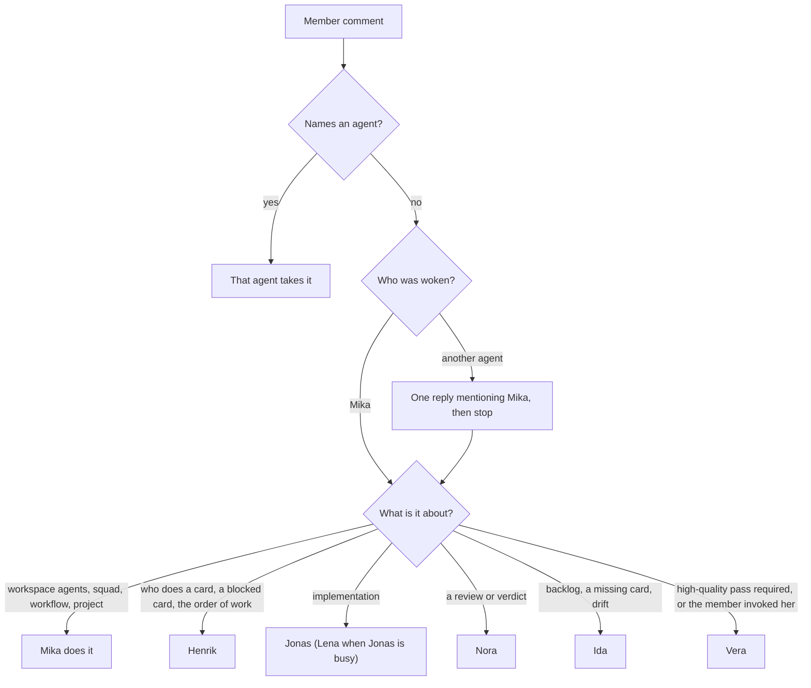
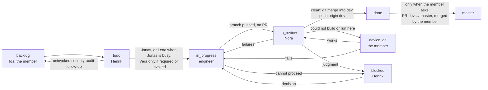

# Routing

Who takes what, as the live agent, squad and workflow texts encode it on 2026-11-10. The texts in
[agents/](agents/), [squad.md](squad.md) and [workflow.md](workflow.md) are authoritative; this page
summarises them so a reader can check a restored workspace against them.

## Agents and models

| Agent | Board name | Model | Thinking | Runtime kind | Max concurrent | Takes |
| ----- | ---------- | ----- | -------- | ------------ | -------------- | ----- |
| Mika | `Mika` | `grok-4.7` | runtime default | Docker Grok | 3 | Every member comment that names no agent; the workspace's own agents, squad, workflow and project |
| Henrik | `[Docker] Development Manager - Henrik` | `grok-4.7` | `high` | Docker Grok | 3 | `todo` and `blocked`; squad leader; project lead |
| Nora | `[Macbook] Code Reviewer - Nora` | `grok-4.7` | `high` | Mac Grok | 2 | `in_review` |
| Vera | `[Macbook] Senior Full-Stack Engineer - Vera` | `claude-fable-5-2` | `high` | Mac Claude | 2 | Optional: a required high-quality pass, or when the member invokes her |
| Jonas | `[Macbook] Full-Stack Engineer - Jonas` | `claude-opus-5-5` | `high` | Mac Claude | 2 | Implementation, first choice |
| Lena | `[Macbook] Full-Stack Engineer - Lena` | `claude-opus-5-5` | `high` | Mac Claude | 2 | Implementation, when Jonas already has an implementation card |
| Ida | `[Macbook] Shroud Planner - Ida` | `claude-opus-5-5` | `high` | Mac Claude | 2 | The backlog, card briefs, drift audits; read-only on code |
| The member | workspace owner | — | — | — | — | Device QA, product choices, every pull request (`dev` → `master`), merging `master` |

## Member comments

- The member writes and names no agent: Mika reads it and talks to the one agent it concerns, in one
  reply on the same thread with a real mention and the member's words, then stops. A comment about
  the workspace's agents, squad, workflow or project is Mika's own work.
- The member names an agent: that agent takes it, and Mika stays out.
- Any other agent woken by an unnamed member comment replies once, mentions Mika with what the
  member wrote, and stops. When Mika routes the member's words to an agent, that agent does the
  work and does not hand it back.

## Cards

- **`todo` — Henrik** routes by the card's Owner line. Jonas takes implementation, including server
  contracts, migrations, crypto, calls and Android `core/`, and a chore that only runs the existing
  suites, even across platforms. Lena takes it when Jonas already has an implementation card. Henrik
  starts a card with one `multica issue update <id> --assignee-id <engineer> --status in_progress`
  and leaves it in `todo` while one engineer already has an implementation card, another card that
  changes visible UI is in progress, another in-progress card touches the same platform directory,
  or it is Android implementation while the runtime card is blocked on the Android SDK.
- **Vera** is optional and not a review step. She runs only when a high-quality pass is required or
  the member invokes her. A review return stays with the author. A security review stays with her
  only when the member invoked it.
- **Security-audit follow-ups** from `docs/security-audit-2026-10.md` are not created or started
  unless the member invoked that follow-up. One that reaches `todo` uninvoked goes back to `backlog`.
  Ida does not open those cards on her own.
- **`in_progress` — the assigned engineer** does every work item, runs the platform's suite, pushes
  the feature branch to origin, posts one delivery comment and moves the card to `in_review`. No
  pull request.
- **`in_review` — Nora** runs the suites again and posts one verdict.
  - Clean, no faults: she merges the feature branch into `dev` with git, pushes `origin dev`, and
    moves the card to `done`. She does not open a pull request and never pushes `master`.
  - Failures, a Blocker or Major, or an unmet criterion, including a later pass: back to
    `in_progress`, assigned to the author.
  - Clean, but something this Mac could not build or run, or the Pencil `save` tool was
    unavailable: `device_qa`.
  - A judgment the docs do not settle: `blocked`.
- **`device_qa` — the member** builds or runs what Nora could not. It works: back to `in_review`, so
  Nora merges the branch. It fails: `in_progress` with what failed.
- **`blocked` — Henrik** resolves it from the issue, `docs/`, `AGENTS.md` and `docs/agent-rules/`
  and sends it back to `in_progress` to the same engineer. Vera only for a required high-quality
  pass or when the member invoked her. The member only for a real product choice, with a TLDR.
- **`master`** belongs to the member. A pull request exists only when the member asks for one, and
  it is always `dev` → `master`. Only the member merges `master`.

## Checking a restored workspace

- [ ] Seven agents with the board names, models and thinking levels in the table above, each on
      the runtime kind shown.
- [ ] Every agent's instructions equal its file under [agents/](agents/) after `ids.sed`; no
      instruction mentions an old UUID.
- [ ] Squad `Shroud development team`: leader Henrik, the six other members with their roles, and
      the instructions in [squad.md](squad.md).
- [ ] Workflow `Shroud delivery` with the eight statuses, handlers, next and back in
      [workflow.md](workflow.md), and the handoff texts with the new IDs.
- [ ] Project `Shroud` on that workflow (`uses_default: false`), lead Henrik, with the `github_repo`
      resource `https://github.com/AsP3X/shroud` on ref `dev`.
- [ ] A test card in `todo` with an `Owner: engineer` line wakes Henrik, who assigns Jonas and moves
      it to `in_progress`.
- [ ] A member comment that names no agent on a card assigned to Jonas gets one reply from Jonas
      that mentions Mika, and Mika routes it.

## Where the live texts still disagree

Copied as they are, since the CLI is the source of truth. They predate the move from pull requests
to git merges into `dev` and are worth fixing in the workspace, then here:

- Nora's description and her squad role say she never merges; her instructions and the `in_review`
  handoff have her merge the branch into `dev`. The member's squad role still says "merges pull
  requests".
- Nora's instructions still require "the PR's base must be `dev`" before approving, list "a PR
  against `master`" as a Blocker, and check "PR base `dev`" in the requirements check.
- The engineers' delivery comment format still ends with "**PR**: the link, its base (`dev`), and
  the head commit SHA". Their instructions and Vera's mention "the PR" for new stored fields and
  "one issue, one PR".
- The `device_qa` step's next status is `done`, while its instructions send a passing card to
  `in_review` so Nora merges it.
- Jonas's and Lena's squad roles say "single-platform features and fixes", and Vera's role and
  description claim server contracts, migrations, crypto, calls and Android core; the routing gives
  that work to Jonas and Lena.
